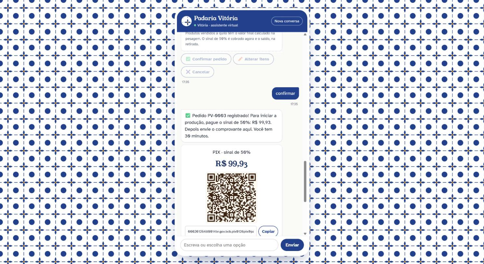
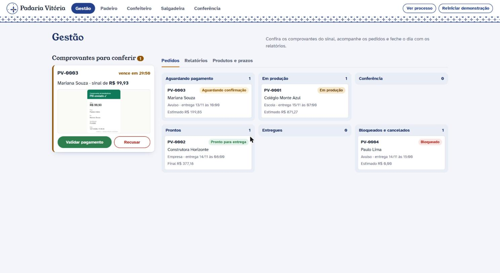
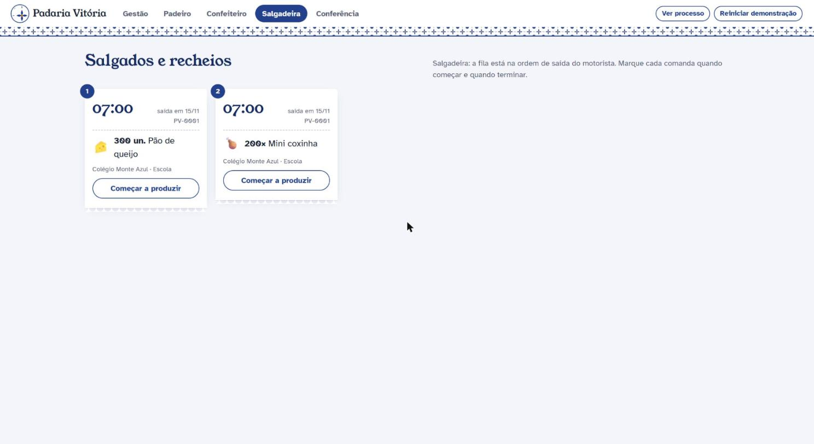
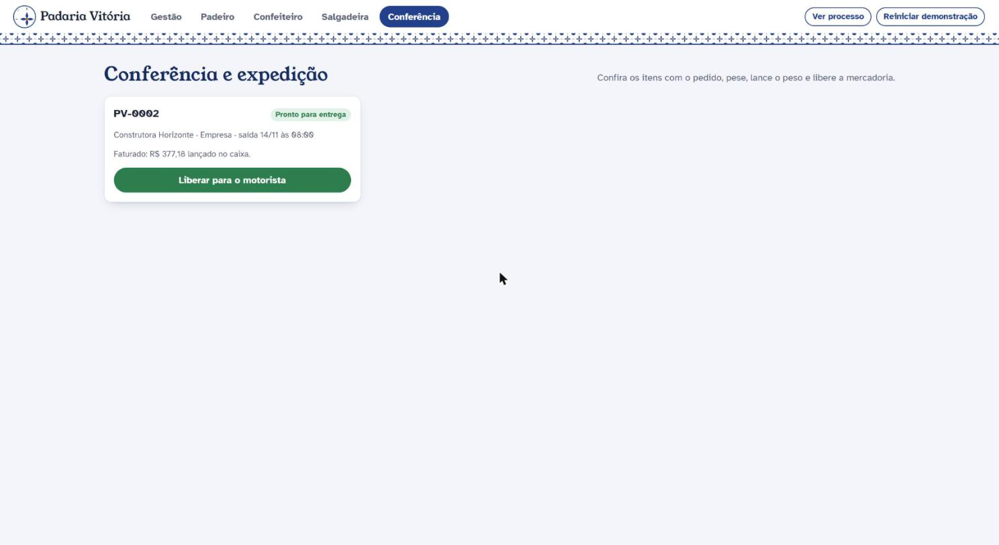
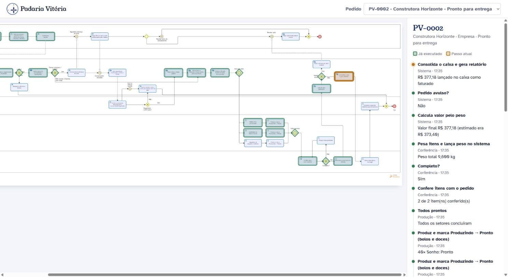

# Chatbot de encomendas da Padaria Vitória

**Proposta de implantação do processo TO-BE de produção dos pedidos**

Projeto acadêmico · PUC · novembro de 2026

---

## 1. Objetivo

A Padaria Vitória recebe encomendas de clientes avulsos, escolas e empresas. A proposta substitui o atendimento manual por um **chatbot de encomendas** ligado a um **painel interno**, para que cada pedido percorra exatamente o processo redesenhado no diagrama TO-BE: da escolha dos produtos à entrega, passando por pagamento do sinal, produção por setor, conferência, pesagem e fechamento do caixa.

O sistema foi construído para demonstração em aula, com **custo zero**. Roda em qualquer computador com Node.js, sem internet, sem conta em serviço externo e sem chave de API.

## 2. O processo TO-BE

O diagrama (arquivo `TO-BE (UM FIM POR POOL).png`, feito no Bizagi) tem cinco raias:

| Raia | Papel no sistema |
|---|---|
| **Cliente** | Conversa com o chatbot: escolhe produtos, informa os dados, confirma, paga o sinal e o saldo. |
| **Sistema** | Motor de regras: classifica, valida, aplica a sazonalidade, cobra, desmembra a comanda, ordena a fila, calcula pelo peso e consolida o caixa. |
| **Gestão** | Confere o comprovante do sinal, valida ou recusa o pagamento e exporta os relatórios do fechamento. |
| **Produção** | Padeiro, confeiteiro e salgadeira veem a fila do seu setor e marcam cada item como "produzindo" e depois "pronto". |
| **Conferência/Expedição** | Confere os itens, devolve à produção o que faltar, pesa, lança o peso e libera a mercadoria. |

## 3. Rastreabilidade: cada atividade do diagrama no sistema

Toda atividade do TO-BE tem um identificador no código (`src/motor/atividades.js`). Cada vez que o sistema executa uma atividade, grava um evento com esse identificador. A tela **Processo** desenha esses eventos por cima do próprio diagrama, de modo que é possível ver, pedido a pedido, por onde ele passou.

| Raia | Atividade no TO-BE | Como o sistema executa |
|---|---|---|
| Cliente | Acessa chatbot via WhatsApp/catálogo web | Chat web com saudação e menu de botões |
| Cliente | Seleciona produtos, preenche dados e informa o tipo | Catálogo com carrinho; o bot pede tipo, nome, telefone, CNPJ (escola/empresa), data e horário |
| Cliente | Confirma o pedido | Resumo em forma de comanda e o botão "Confirmar pedido" |
| Sistema | Classifica: escola, empresa ou individual | O cadastro da padaria prevalece: um CNPJ cadastrado como escola continua escola, mesmo que o cliente diga "empresa" |
| Sistema | Valida itens e duplicidades de pedidos | Produto ativo, quantidade mínima e máxima, produto sazonal só no período, data futura, horário de funcionamento, CNPJ válido e pedido idêntico já aberto |
| Sistema | Válido? Não → Bloqueia e informa o motivo | O pedido fica **Bloqueado** e o motivo aparece no chat |
| Sistema | Aplica regras de sazonalidade e ajusta prazo | Antecedência mínima: avulso 1 dia, escola/empresa 2 dias, Natal e Páscoa 3, Festa Junina 2, mais 1 dia acima de 200 unidades. Se a data pedida for cedo demais, ela é **ajustada**, não bloqueada |
| Sistema | Cliente individual/avulso? | Escola e empresa vão direto para a produção (faturadas, sem sinal) |
| Sistema | Calcula e envia cobrança do sinal | 50% do valor estimado, com QR Code PIX e "copia e cola" |
| Cliente | Paga 50% do sinal e envia comprovante | Envio da imagem pelo chat |
| Sistema | Comprovante recebido → Aguardando confirmação e notifica a Gestão | O comprovante aparece em tempo real no painel da gestão |
| Sistema | Prazo de validação expirado | Relógio de 30 minutos (2 no modo demonstração); ao vencer, cancela sozinho |
| Gestão | Confere comprovante e clica em Validar pagamento | Botões "Validar pagamento" e "Recusar" |
| Sistema | Cancela o pedido e avisa o cliente | Pagamento recusado ou prazo vencido: o pedido fica **Cancelado** e o aviso chega no chat |
| Sistema | Altera status e libera pedido | O pedido fica **Liberado** e o sinal entra no caixa |
| Sistema | Desmembra a comanda e libera tarefas | Uma tarefa por item, no setor do produto |
| Sistema | Ordena a fila pelo horário de saída do motorista | A fila de cada setor segue data e horário de saída; item devolvido pela conferência passa na frente quando empata |
| Produção | Padeiro / Confeiteiro / Salgadeira veem sua cota | Uma tela por setor, com comandas numeradas na ordem |
| Produção | Produz e marca Produzindo → Pronto | Não é possível pular etapa nem voltar |
| Produção | Todos prontos | O pedido só vai para a conferência quando **todos** os setores terminam |
| Conferência | Confere itens com o pedido | Lista de verificação item a item |
| Conferência | Completo? Não → Produzir item pendente | O item faltante volta para a fila do setor marcado como pendente |
| Conferência | Pesa itens e lança o peso | Campo de peso por item, com o valor calculado na hora |
| Sistema | Calcula valor pelo peso | Produto a quilo: peso × preço; produto por unidade: quantidade × preço |
| Sistema | Pedido avulso? Sim → Envia cobrança do saldo | Saldo = valor final − sinal, com novo PIX no chat |
| Cliente | Pagar saldo final e retirar pedido | A expedição recebe o saldo no balcão e entrega |
| Sistema | Pedido avulso? Não → Consolida o caixa e gera relatório | O valor da escola/empresa entra no caixa como "a faturar" |
| Conferência | Liberar mercadoria (entrega) | "Liberar para o motorista" |
| Gestão | Consultar e exportar relatórios para fechamento | Relatórios por período, CSV, impressão em PDF e "Fechar o dia" |

## 4. Regras de negócio no código, não só no texto

As decisões que têm efeito no mundo real (cobrar, liberar para produção, cancelar, calcular valor) são tomadas por **funções determinísticas** em `src/motor/`. O chatbot só coleta os dados e mostra o resultado; ele não decide nada sozinho. Além disso, o ciclo de vida do pedido é uma máquina de estados: qualquer tentativa de pular etapa (por exemplo, liberar para a produção sem o sinal validado) é **recusada pelo sistema**.

- **Avulso:** Rascunho → Aguardando sinal → Aguardando confirmação → Liberado → Em produção → Em conferência → Aguardando saldo → Entregue → Fechado.
- **Escola ou empresa:** Rascunho → Liberado → Em produção → Em conferência → Pronto para entrega → Entregue → Fechado.
- **Saídas antecipadas:** Bloqueado (não passou na validação) e Cancelado (pagamento recusado ou prazo vencido).
- **Retorno:** Em conferência volta para Em produção quando falta algum item.

## 5. Arquitetura

| Camada | Tecnologia | Por quê |
|---|---|---|
| Servidor | Node.js 24 + Express | Simples, gratuito, roda em qualquer PC |
| Banco | SQLite nativo do Node (`node:sqlite`) | Um arquivo só; nada para instalar ou compilar |
| Tempo real | Server-Sent Events | O chat e o painel se atualizam sozinhos, ideal para demonstrar em duas janelas lado a lado |
| Telas | HTML, CSS e JavaScript puros | Sem etapa de build; fontes guardadas no projeto, funciona offline |
| PIX | QR Code gerado localmente (padrão BR Code do Banco Central) | Formato real, chave fictícia, custo zero |

Pastas principais:

```
src/motor/      regras do TO-BE (funções puras, testadas)
src/processo.js orquestra o TO-BE: banco + motor + avisos ao chat e ao painel
src/bot/        conversa do chatbot por botões
src/servidor.js API HTTP e canal de tempo real
public/         telas: início, chat, painel e processo
test/           testes automáticos
```

## 6. Telas

**Chat do cliente.** Conversa por botões no estilo de aplicativo de mensagens, catálogo com carrinho, resumo do pedido e cobrança PIX com contagem regressiva.



**Gestão.** Fila de comprovantes com o prazo correndo, quadro dos pedidos por situação, relatórios e cadastro de produtos e prazos.



**Produção.** Uma tela por setor; cada item é uma comanda numerada na ordem de saída do motorista.



**Conferência e expedição.** Lista de verificação, pesagem com valor calculado na hora e liberação da mercadoria.



**Processo.** O diagrama TO-BE com os passos já executados em verde e o passo atual em destaque, mais a linha do tempo do pedido.



## 7. Qualidade

- **23 testes automáticos** (`npm test`): 18 de regras isoladas e 5 de fluxo completo pela API: pedido avulso com item pendente e saldo, escola sem sinal com prazo ajustado, bloqueios por duplicidade e CNPJ inválido, cancelamentos por recusa e por prazo, e relatório com CSV.
- **Teste de mutação:** cada guarda principal foi desligada, uma por vez (duplicidade, sinal só para avulso, "todos prontos", ajuste de prazo, máquina de estados e prazo de validação), e em todos os casos a suíte ficou vermelha. Isso mostra que os testes de fato protegem as regras.
- Telas conferidas no navegador, inclusive na largura de celular (360 e 414 px), sem rolagem horizontal.

## 8. Custo

| Item | Custo |
|---|---|
| Node.js, Express, SQLite, bibliotecas | R$ 0 (software livre) |
| Hospedagem | R$ 0 (roda no computador da apresentação) |
| Pagamento | R$ 0 (PIX simulado; a gestão valida o comprovante manualmente, como no TO-BE) |
| Inteligência artificial | Não usada: o bot funciona por botões e é 100% previsível |

## 9. Limitações e próximos passos

- O canal é um chat web. Em produção, o mesmo motor poderia atender pelo **WhatsApp Cloud API**: só a camada de conversa mudaria.
- O PIX é simulado. Uma integração com banco (PIX dinâmico com confirmação automática) eliminaria a conferência manual do comprovante.
- O painel não tem login por perfil, porque é uma demonstração. Em produção, cada pessoa teria seu acesso.
- O relatório de fechamento poderia gerar a nota de cobrança das escolas e empresas faturadas.
